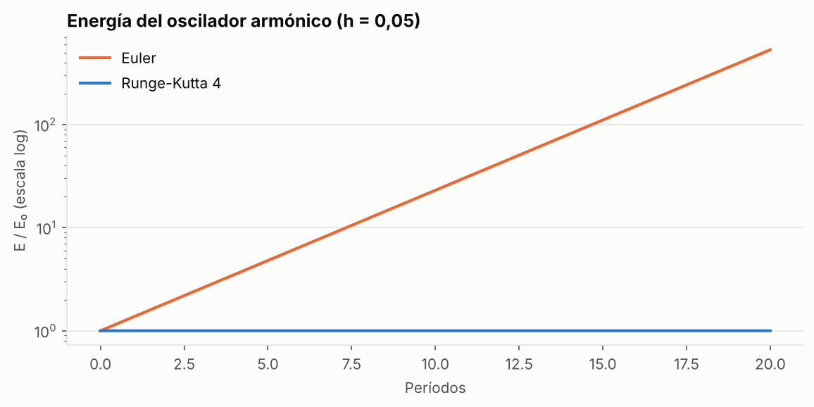
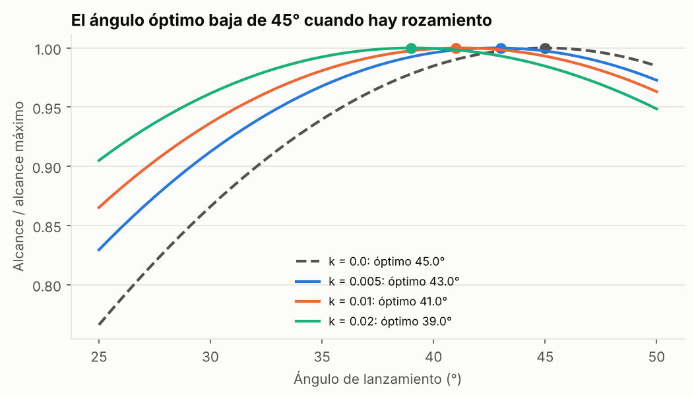
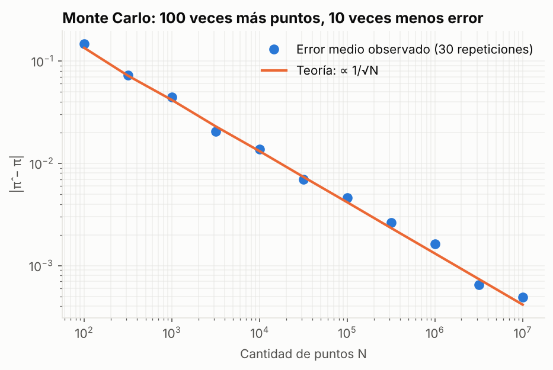
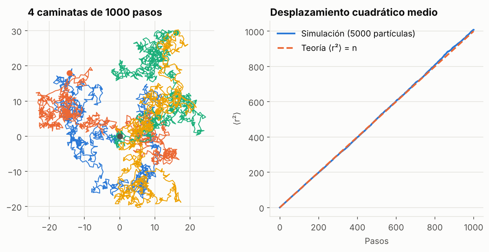

# Simulación numérica en física


> 🇬🇧 **English summary:** Numerical methods implemented from scratch with NumPy: Euler and Runge-Kutta 4 integrators with measured convergence order, projectile motion with quadratic air drag (the optimal launch angle drops below 45°), Monte Carlo estimation with 1/√N error scaling, and 2D random walks reproducing diffusion. Each method is validated against exact solutions and covered by tests.

Proyecto que aplica lo aprendido en la Licenciatura en Física (UNLP). Implemento los métodos **desde cero**, sin `scipy.integrate`, para medir cuánto se equivocan y por qué.

📓 **Notebook completo con gráficos:** [`notebooks/simulaciones.ipynb`](notebooks/simulaciones.ipynb)

## Resultados

### El método numérico puede inventar física



Con el mismo paso de tiempo, Euler hace que un oscilador sin rozamiento termine con **530 veces su energía inicial** en 20 períodos. RK4 la conserva hasta la sexta cifra.

### Orden de convergencia medido

| Método | Orden teórico | Orden medido | Pasos para error 10⁻⁶ |
|---|---:|---:|---:|
| Euler | 1 | 1,05 | más de 10 millones |
| Runge-Kutta 4 | 4 | 4,00 | menos de 100 |

### El ángulo óptimo no siempre es 45°



Con rozamiento del aire no hay solución analítica. La simulación muestra que conviene lanzar más bajo: para una pelota de fútbol a 30 m/s ($k ≈ 0{,}01$ m⁻¹) el óptimo es **41°** y el alcance cae de 92 m a 56 m.

### Monte Carlo y difusión

| Monte Carlo: error ∝ 1/√N | Difusión: ⟨r²⟩ ∝ t |
|---|---|
|  |  |

## Estructura

```
├── src/
│   ├── integradores.py   # Euler, RK4, oscilador, proyectil con rozamiento
│   └── montecarlo.py     # estimación de π, caminatas aleatorias, ⟨r²⟩
├── notebooks/simulaciones.ipynb
├── tests/test_metodos.py # órdenes de convergencia, casos con solución exacta
└── figuras/
```

## Cómo ejecutarlo

```bash
git clone https://github.com/Lu1sPerez/simulaciones-fisica.git
cd simulaciones-fisica
pip install -r requirements.txt
pytest -v
jupyter notebook notebooks/simulaciones.ipynb
```

## Por qué está en un portfolio de datos

Las mismas ideas se usan todos los días en análisis de datos: **validar** un modelo contra casos conocidos antes de confiar en él, **cuantificar el error** en lugar de reportar un número suelto, y **simular escenarios** cuando no hay fórmula cerrada.

---
**Autor:** Luis Pérez · [LinkedIn](https://www.linkedin.com/in/perezluis24/) · Analista de Datos | BI | Automatización
